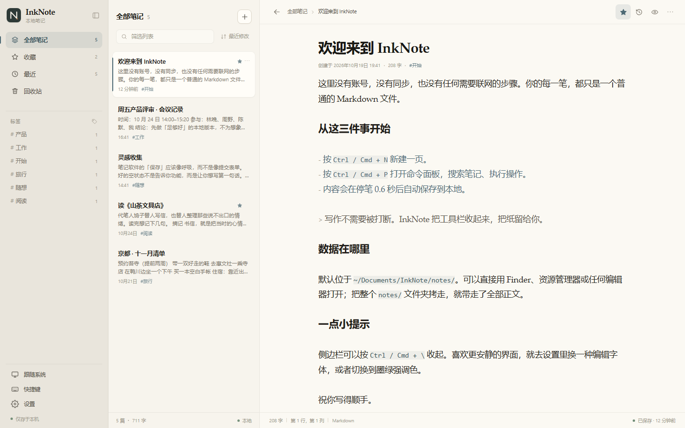
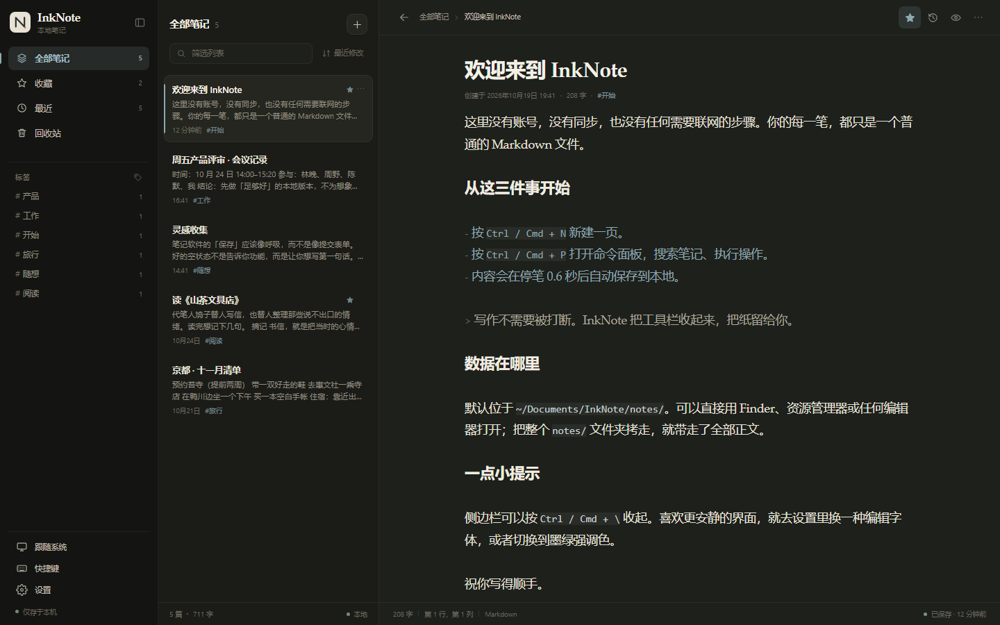
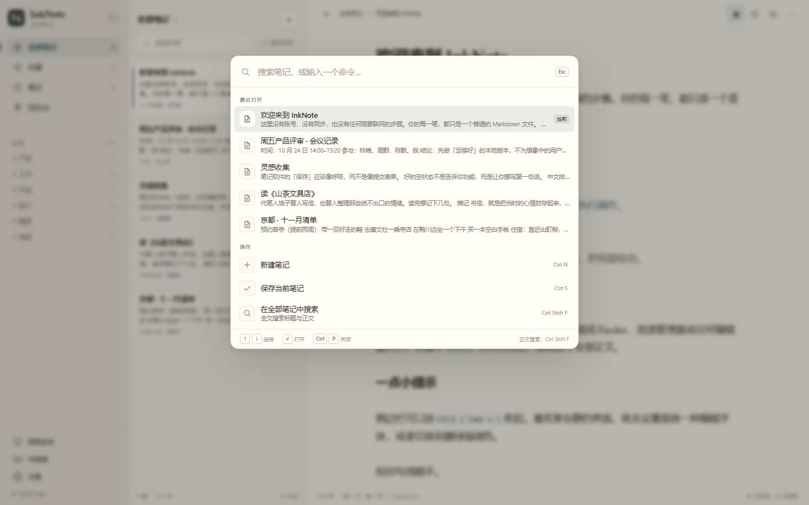
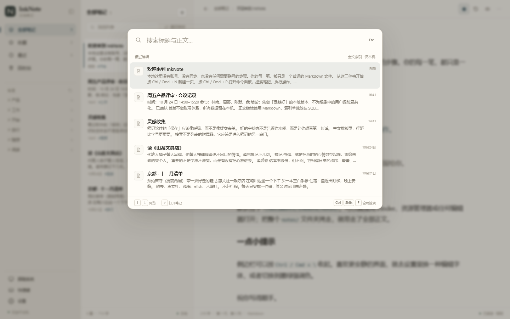
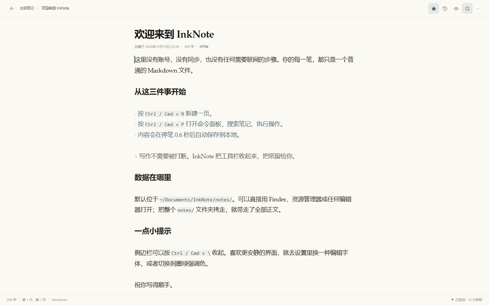
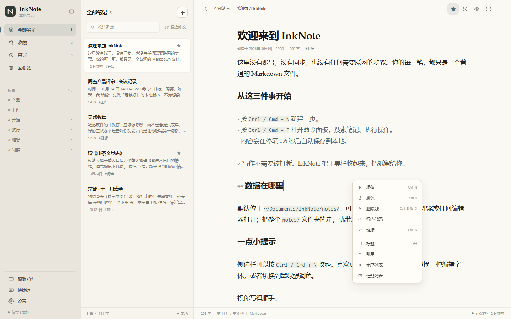

# InkNote

> 一个安静、克制、完全本地的 Markdown 记事本。

InkNote 用 Tauri 2 和 React 写成。没有账号，没有云同步，没有遥测；正文是普通的 `.md` 文件，搜索索引放在本机 SQLite 中。打开就能写，关掉就安静地留在磁盘上。



| 暗色 | 命令面板 |
| --- | --- |
|  |  |

| 全文搜索 | 小屏布局 |
| --- | --- |
|  |  |

| 专注模式 | 格式化菜单 |
| --- | --- |
|  |  |

## 特性

- **打开即写**：新建笔记后 0.65 秒自动落盘，切换、失焦、关闭前强制保存。
- **数据可带走**：`notes/` 里只有纯 Markdown，复制整个文件夹即可迁移；索引缺失时会从文件名中的 id 自动重建。
- **中文搜索**：SQLite FTS5 + trigram，短词自动回退到 `LIKE`，支持标题与正文的高亮片段。
- **三栏但克制**：侧边栏、列表、编辑区；侧栏可折叠，列表宽度可拖拽并记忆（双击复位），窄屏变成抽屉，小屏变成列表 / 编辑器两级；`Ctrl/Cmd + Shift + Enter` 进入专注模式，只保留当前笔记。
- **最近打开**：按真实打开顺序记录最近笔记，而不是简单按更新时间伪造。
- **Markdown 格式化**：`Ctrl/Cmd + B/I/K` 与编辑区右键菜单，覆盖粗体、斜体、删除线、行内代码、链接、标题、引用和列表。
- **命令面板**：`Ctrl/Cmd + P` 统一搜索笔记、执行命令、切换外观。
- **可靠性**：原子写入、崩溃草稿、5 分钟快照、20 份版本上限、外部修改检测、软删除 30 天。
- **可恢复**：全局错误边界、保存失败重试、对话框焦点陷阱，异常时优先保护本地文件。
- **界面**：CSS 变量设计令牌；亮色 / 暗色 / 跟随系统；蓝灰、墨绿、暖橙三种低饱和强调色；衬线 / 黑体 / 等宽编辑字体。
- **零网络依赖**：打开、编辑、搜索、导入导出全部离线完成。

## 快捷键

| 动作 | 快捷键 |
| --- | --- |
| 新建笔记 | `Ctrl/Cmd + N` |
| 保存 | `Ctrl/Cmd + S` |
| 当前笔记搜索 | `Ctrl/Cmd + F` |
| 粗体 / 斜体 / 链接 | `Ctrl/Cmd + B` / `I` / `K` |
| 格式化菜单 | 编辑区右键 |
| 全局搜索 | `Ctrl/Cmd + Shift + F` |
| 命令面板 | `Ctrl/Cmd + P` |
| 最近笔记切换 | `Ctrl + Tab`（macOS 的 `⌘ + Tab` 被系统保留） |
| 折叠侧边栏 | `Ctrl/Cmd + \` |
| 切换 Markdown 预览 | `Ctrl/Cmd + Shift + V` |
| 专注模式 | `Ctrl/Cmd + Shift + Enter` |
| 版本历史 | `Ctrl/Cmd + Shift + H` |
| 聚焦标题 | `Ctrl/Cmd + Shift + E` |
| 设置 | `Ctrl/Cmd + ,` |
| 快捷键一览 | `?` |

## 技术栈

| 模块 | 选型 |
| --- | --- |
| 桌面壳 | Tauri 2 |
| 前端 | React 19 + TypeScript + Vite |
| 编辑器 | CodeMirror 6（Markdown 增量解析、实时隐藏非当前行标记） |
| 状态 | Zustand |
| 样式 | 原生 CSS 变量，无 UI 框架 |
| 索引 | SQLite + FTS5（Rust `rusqlite`，bundled SQLite） |
| 正文 | 独立 Markdown 文件 |
| 打包 | Tauri Bundler + GitHub Actions |

## 数据布局

默认数据目录：`~/Documents/InkNote/`（Windows 为 `%USERPROFILE%\Documents\InkNote\`）。

```text
InkNote/
├─ notes/
│  └─ 2026-10-25-会议记录-a1b2c3d4.md
├─ .index/
│  └─ notes.db
├─ .history/
│  └─ a1b2c3d4/
│     ├─ 20261025T101500-120.md
│     └─ 20261025T104200-840.md
├─ .drafts/
│  └─ a1b2c3d4.draft
├─ .trash/
│  └─ a1b2c3d4-1761393600000.md
└─ config.json
```

- 正文不带 YAML frontmatter，任何编辑器打开都是正文。
- 文件名格式为 `日期-标题slug-id8.md`，id 保证重命名后仍能识别。
- `file_path` 在索引中记录绝对路径；迁移后启动扫描会按 id 重新指向新位置。
- 导出时生成带 frontmatter 的标准 Markdown，导入时自动剥离 frontmatter 并恢复标题和标签。

核心表：

```sql
notes(id, title, file_path, created_at, updated_at, file_mtime,
      favorite, deleted_at, word_count, excerpt);
tags(id, name);
note_tags(note_id, tag_id);
notes_fts USING fts5(note_id UNINDEXED, title, content, tokenize='trigram');
```

## 开发

前置条件：

- Node.js 20.19+
- pnpm 11
- Rust stable
- 各平台 Tauri 2 依赖：
  - Windows：Visual Studio Build Tools（Desktop development with C++）+ WebView2 Runtime
  - macOS：Xcode Command Line Tools
  - Linux：`libwebkit2gtk-4.1-dev`、`libappindicator3-dev`、`librsvg2-dev`、`patchelf` 等

```bash
pnpm install
pnpm tauri dev      # 桌面应用
pnpm dev            # 仅浏览器演示（数据在 localStorage）
pnpm build          # 类型检查 + 前端生产构建
pnpm tauri build    # 生成平台安装包
```

浏览器演示模式使用同一套前端 API 契约，数据落在 `localStorage`，用于快速查看界面与交互；桌面版会通过 Tauri `invoke` 调用 Rust 命令，不直接拥有文件系统权限。

### 测试

```bash
pnpm test           # Vitest，文本与时间工具
pnpm build          # 先构建前端，供 Tauri generate_context 使用
cargo test --manifest-path src-tauri/Cargo.toml
```

前端端到端检查（使用本机 Chrome 和 `playwright-core`）：

```bash
pnpm dev            # 终端 A
node scripts/e2e.mjs # 终端 B
```

该脚本覆盖最近打开、专注模式、列表宽度拖拽、自动保存、新建、Markdown 格式化快捷键与右键菜单、命令面板、焦点陷阱、全文搜索、三档主题、版本历史、回收站恢复、草稿恢复、外部修改冲突、移动端布局，共 39 项断言。

### 性能观察

本地 Chromium + 浏览器演示后端注入 10,000 条笔记（生产构建）：

- 冷启动到列表可交互：约 0.84s
- 列表实际渲染：17 行（虚拟滚动）
- 全文搜索：约 135ms
- 连续滚到底部 8 次：约 0.56s，无白屏或运行时错误

```bash
pnpm build
pnpm preview -- --port 4173
node scripts/perf.mjs
```

## 构建与发布

GitHub Actions 提供两份工作流：

- `.github/workflows/ci.yml`：前端类型检查 / 构建 / Vitest，Rust `cargo fmt --check` 与 `cargo test`。
- `.github/workflows/release.yml`：推送 `v*` 标签时矩阵构建 Windows `.msi`/NSIS、macOS `.dmg`（arm64 与 x64）、Linux `.AppImage`/`.deb`，并额外生成 Windows 便携 zip。

Windows 便携包解压后可直接运行 `InkNote.exe`，但系统仍需 WebView2 Runtime（Windows 10/11 通常已预装）。便携包额外提供 `InkNote-Portable.cmd`：通过它启动时数据保存在同目录的 `InkNoteData/`，适合放进 U 盘；也可以手动设置环境变量 `INKNOTE_DATA_DIR` 指向任意数据目录。安装包不联网、不收集遥测；应用本身没有网络请求。

## 目录结构

```text
inknote/
├─ src/
│  ├─ components/       # 侧栏、列表、编辑器、面板、对话框
│  ├─ hooks/            # 主题、快捷键、点击外部
│  ├─ lib/              # Tauri API 桥、浏览器演示后端、文本与时间工具
│  ├─ store/            # Zustand 应用状态、自动保存编排
│  └─ styles/           # 设计令牌与界面样式
├─ src-tauri/
│  ├─ src/
│  │  ├─ commands.rs    # 白名单 Tauri 命令
│  │  ├─ db.rs          # SQLite schema、索引、FTS5 搜索
│  │  ├─ storage.rs     # 数据目录、原子写、快照、草稿、回收站、reconcile
│  │  ├─ models.rs      # DTO 与 Settings
│  │  ├─ text.rs        # slug、Markdown 清理、标签、片段
│  │  └─ error.rs       # 结构化错误
│  ├─ capabilities/     # 最小权限声明
│  └─ tauri.conf.json
├─ docs/
├─ scripts/             # Playwright 截图 / e2e / 10k 性能检查 / Windows 便携启动器
└─ .github/workflows/
```

## 关键实现

### 保存协议

1. 前端停笔 650ms 后调用 `save_note(id, title, content, baseMtime)`。
2. Rust 先比较磁盘 mtime 与 `baseMtime`；不一致且未强制时返回 `external_conflict`。
3. 内容写入同目录临时文件，`sync_all` 后原子 rename 替换。
4. 更新 SQLite 元数据、FTS 与标签；成功后删除 `.drafts/{id}.draft`。
5. 手动保存或距上次快照超过 5 分钟时写入 `.history/{id}/`，最多保留 20 份。

### 搜索

- 3 个字符以上的查询使用 FTS5 trigram phrase + `bm25` 排序。
- 更短的查询（中文两字、单字）回退到 `notes_fts.content LIKE`，避免 trigram 最小长度限制。
- FTS 不可用时同样走 `LIKE` 兜底；结果片段在 Rust 侧生成 `<mark>`，前端用 DOMPurify 只允许 `mark` 标签。

### 外部修改

启动时 `reconcile()` 扫描 `notes/`：

- 已知 id 更新路径 / mtime 并重新索引；
- 未知 id 从文件名和 H1 恢复元数据；
- 没有 id 的 Markdown 自动补 id 并重命名为规范文件名；
- DB 中存在但文件消失的活动笔记标记为软删除。

窗口重新获得焦点时只 stat 活动文件，发现 mtime 变化才读取并重建索引；如果此时编辑器有未保存内容，前端展示冲突条，让用户选择重新载入或保留本地版本。

## 边界与已知限制

首版刻意不做云同步、账号、协作、插件市场、内置 AI 和附件目录。以下能力留到后续阶段：

- 首次启动图形化选择数据目录（当前默认目录 + `INKNOTE_DATA_DIR` / 便携启动器；可手动迁移数据后重启重建索引）。
- 标签的图形化编辑（当前从正文 `#标签` 自动提取，并可在侧栏筛选）。
- 单篇笔记加密。
- Markdown 预览中的外链在桌面端通过系统浏览器打开。
- 自动更新（不引入联网检查）。

## 项目地址

<https://github.com/cjy-kenny/inknote>

## License

MIT
